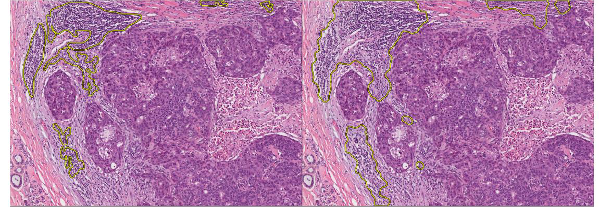
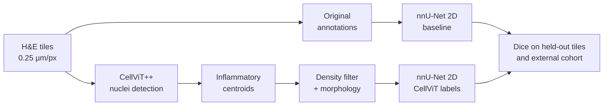

# TIL-region segmentation in breast cancer histopathology

[](https://github.com/27pepablo/til-segmentation-histopathology/actions/workflows/ci.yml)

[](LICENSE)

Segmenting regions rich in **tumour-infiltrating lymphocytes (TILs)** in H&E-stained
breast cancer tissue with **nnU-Net**, and improving the training labels with
cell-level detections from **CellViT++**.

Code for my Bachelor's thesis in Biomedical Engineering at Universidad Politécnica
de Madrid (ETSIT-UPM, 2025), carried out in the Biomedical Image Technologies (BIT)
group. The full thesis (in Spanish) is in [`docs/thesis_ES.pdf`](docs/thesis_ES.pdf).



*TIL-region labels for the same TCGA tile. Left: original dataset annotation, fragmented
and incomplete. Right: region derived from CellViT++ lymphocyte detections with the
method in this repository.*

## Why

TIL density is a prognostic and predictive biomarker in breast cancer, but
pathologists score it by eye, which is slow and varies between observers. A model that
outlines TIL-rich regions makes the measurement objective and repeatable.

The obstacle is the labels. Public region annotations of lymphocytic infiltrate are
inconsistent: the same kind of tissue is outlined tightly in one image and loosely or
not at all in another, and a segmentation network trained on them inherits that noise.

## Approach

1. **Baseline.** Train nnU-Net (2D) on the original TIL-region annotations of two
   public datasets.
2. **Relabel.** Run CellViT++ (pretrained, no fine-tuning) on the same images to
   detect and classify every nucleus, keep the *inflammatory* cells, and convert those
   points into regions: local-density filter → rasterise → dilation → morphological
   closing.
3. **Retrain.** Train the same nnU-Net configuration on the CellViT-derived regions.
4. **External test.** Apply both models to tiles from an independent hospital cohort.



The cell-to-region step is the part written for this project; it is small enough to
show whole. Every stage of it, on synthetic detections:


*Produced by [`examples/synthetic_demo.py`](examples/synthetic_demo.py). Isolated
lymphocytes are dropped by the density filter; aggregates become smooth regions that
follow concave shapes, which a convex hull (right, with the chosen method outlined in
orange) cannot do.*

## Results

Dice per image, mean ± standard deviation over the evaluation images
(thesis, Table 3).

| Training labels | Trained on | Evaluated on | Dice |
|---|---|---|---|
| Original annotations | Crowdsourcing (TCGA), 121 tiles | 30 held-out tiles | 0.60 ± 0.25 |
| **CellViT++-derived** | Crowdsourcing (TCGA), 121 tiles | 30 held-out tiles | **0.80 ± 0.25** |
| Original annotations | Crowdsourcing (TCGA) | External cohort, 87 ROIs | 0.58 ± 0.22 |
| **CellViT++-derived** | Crowdsourcing (TCGA) | External cohort, 87 ROIs | **0.68 ± 0.23** |
| Original annotations | BCSS-WSSS patches | Held-out patches | 0.62 ± 0.33 |


Predictions of the two models on the same TCGA tile (left: trained on original
annotations; right: trained on CellViT-derived labels):


### How to read these numbers

- **Each model is scored against the label definition it was trained on.** The
  0.60 → 0.80 gain shows that CellViT-derived regions are a more consistent, more
  learnable target. It does not by itself show they are closer to what a pathologist
  would draw.
- **The external cohort has no pathologist region annotations.** Its reference masks
  were produced with the same CellViT++ procedure, so that comparison favours the model
  trained on that label definition. What it does show is that the model reproduces
  those regions on tissue from a different hospital and scanner.
- **One train/test split, one training run per model.** Each model was trained once on
  the full training set (nnU-Net `all` fold) for 500 epochs, so there are no
  cross-validation or seed-to-seed error bars. The ± values are spread across images,
  which is large: a few images score near zero in every experiment.
- **BCSS-WSSS masks are pseudo-labels** from a weakly supervised model, not manual
  annotations.

The natural next step is a reader study: pathologist-drawn regions on a subset of the
external cohort, to measure both label definitions against the same expert reference.

## Repository layout

```
src/tilseg/
    masks.py            multi-class dataset masks -> binary TIL masks
    nnunet_dataset.py   nnU-Net v2 raw dataset (naming, 80/20 split, dataset.json)
    cellvit_io.py       CellViT++ GeoJSON reader, file-list writer
    til_regions.py      cell centroids -> TIL-region masks  (core contribution)
    metrics.py          Dice / IoU / precision / recall per image, summaries
    viz.py              contour overlays, side-by-side panels, box plots
    cli.py              `tilseg` command-line interface
scripts/
    train_nnunet.sh         plan + preprocess + train + predict + evaluate
    run_cellvit.sh          PNG -> pyramidal TIFF -> CellViT++ inference
    nnUNetTrainer_500ep.py  500-epoch nnU-Net trainer
examples/
    synthetic_demo.py   runs the cell-to-region step without any dataset
    plot_results.py     draws the results figure from docs/results.json
tests/                  36 unit and end-to-end tests
docs/
    reproduce.md        step-by-step reproduction of the thesis experiments
    thesis_ES.pdf       full thesis (Spanish)
```

## Quick start

No dataset or GPU is needed to run the core method:

```bash
git clone https://github.com/27pepablo/til-segmentation-histopathology.git
cd til-segmentation-histopathology
pip install -e ".[dev]"

pytest                              # 36 tests
python examples/synthetic_demo.py   # regenerates docs/figures/synthetic_demo.png
```

From Python:

```python
from tilseg import cellvit_io, til_regions

tils = cellvit_io.load_centroids("slide_cell_detection.geojson")   # (N, 2) x, y
mask = til_regions.region_mask(tils, shape=(2048, 2048))           # uint8, 1 = TIL region
print(f"{100 * til_regions.til_area_fraction(mask):.1f}% of the tile is TIL-rich")
```

## Reproducing the experiments

The full pipeline needs the public datasets, an nnU-Net v2 environment, a CellViT++
environment and a GPU. [`docs/reproduce.md`](docs/reproduce.md) has every command; in
short:

```bash
# 1. Binary TIL masks from the dataset annotations
tilseg binarize --dataset crowdsourcing --src data/crowd/masks --dst data/crowd/til_masks

# 2. nnU-Net dataset with an 80/20 split, then train + predict + evaluate
tilseg build-dataset --images data/crowd/images --labels data/crowd/til_masks \
    --nnunet-raw "$nnUNet_raw" --id 111 --name TILsCrowd
scripts/train_nnunet.sh 111

# 3. CellViT++ detections -> region masks
scripts/run_cellvit.sh data/crowd/images work/cellvit /path/to/CellViT-plus-plus CellViT-SAM-H-x40-AMP.pth
tilseg til-masks --geojson work/cellvit/segmented --images data/crowd/images --out work/cellvit_masks

# 4. Same images and split, new labels; retrain
cp -r "$nnUNet_raw/Dataset111_TILsCrowd" "$nnUNet_raw/Dataset444_TILsCellViT"
tilseg replace-labels --dataset "$nnUNet_raw/Dataset444_TILsCellViT" --labels work/cellvit_masks
scripts/train_nnunet.sh 444
```

## Data

No images, masks or model weights are distributed here.

| Dataset | Use | Source |
|---|---|---|
| CrowdsourcingDataset-Amgadetal2019 (BCSS) | 151 TCGA breast ROIs at 0.25 µm/px with region annotations | [CancerDataScience/CrowdsourcingDataset-Amgadetal2019](https://github.com/CancerDataScience/CrowdsourcingDataset-Amgadetal2019) |
| BCSS-WSSS | 224×224 patches with pseudo-label masks; the 1,112 patches containing lymphocyte regions were used | [ChuHan89/WSSS-Tissue](https://github.com/ChuHan89/WSSS-Tissue) |
| External cohort | 87 ROIs of 2048×2048 px from 15 H&E slides, Hospital Universitario Ramón y Cajal | Clinical data, not public |

## Built on

- **nnU-Net v2**: Isensee et al., *Nature Methods* 2021. [MIC-DKFZ/nnUNet](https://github.com/MIC-DKFZ/nnUNet)
- **CellViT / CellViT++**: Hörst et al., *Medical Image Analysis* 2024. [TIO-IKIM/CellViT-plus-plus](https://github.com/TIO-IKIM/CellViT-plus-plus)
- **BCSS**: Amgad et al., *Bioinformatics* 2019.
- **WSSS-Tissue**: Han et al., *Medical Image Analysis* 2022.

## Citation

```bibtex
@thesis{perezgomez2025tils,
  author = {Pérez Gómez, Pablo},
  title  = {Implementación de algoritmos para la segmentación de regiones con linfocitos
            infiltrantes tumorales en imágenes histopatológicas de cáncer de mama
            mediante técnicas de aprendizaje profundo},
  school = {Universidad Politécnica de Madrid, ETSI de Telecomunicación},
  type   = {Bachelor's thesis},
  year   = {2025}
}
```

## Acknowledgements

Supervised by Juan Martínez-Aedo Castro, with Irene Carretero Barrio as co-supervisor
and María Jesús Ledesma Carbayo as academic tutor, at the Biomedical Image Technologies
group (ETSIT-UPM). The external cohort and the clinical context come from
Hospital Universitario Ramón y Cajal, Madrid.

## License

Code: [MIT](LICENSE). The thesis document and its figures remain © the author; the
histology shown in the figures comes from TCGA public data.
