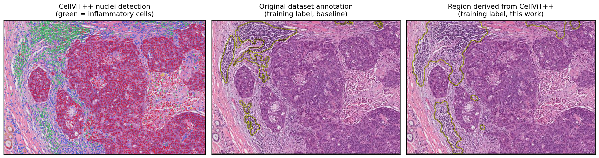
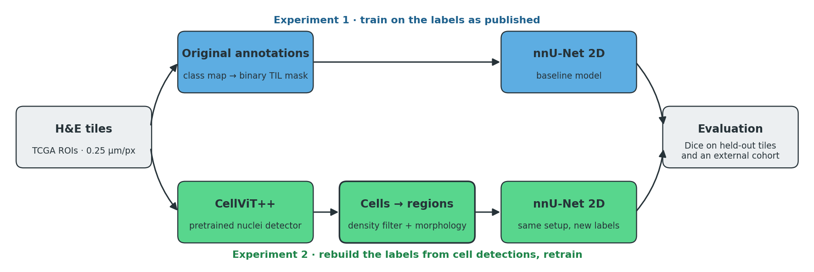
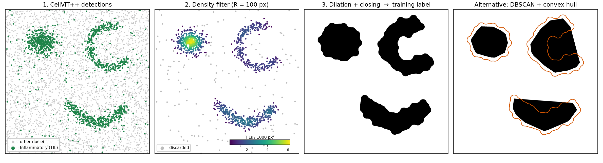
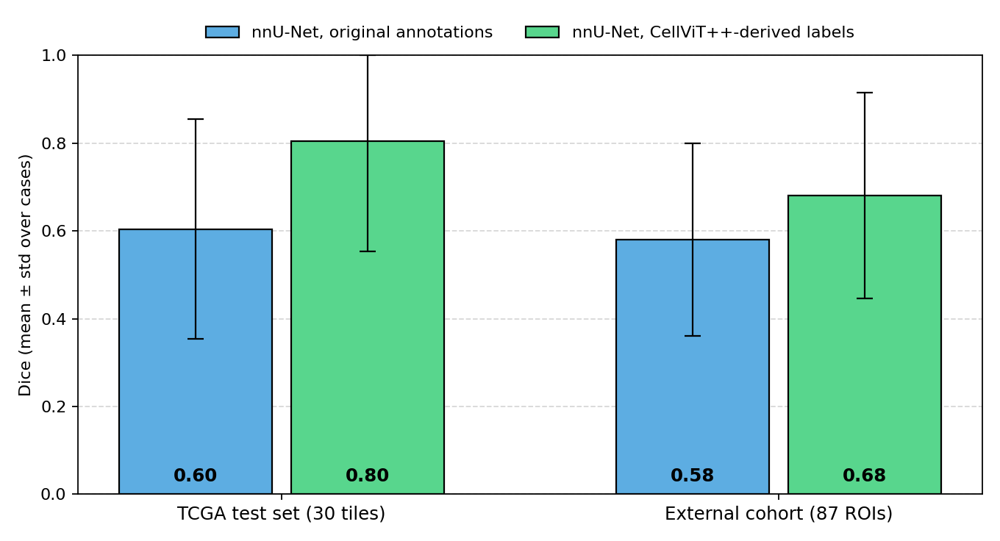
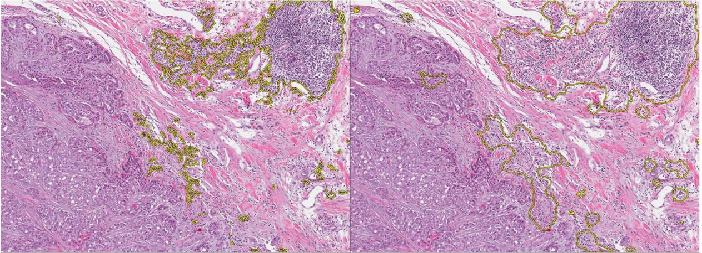
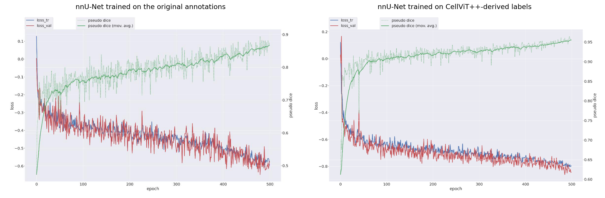

<h1 align="center">TIL-region segmentation in breast cancer histopathology</h1>

<p align="center">
  <b>Better training labels from cell detections: nnU-Net + CellViT++ on H&E tissue</b>
</p>

<p align="center">
  <a href="https://github.com/27pepablo/til-segmentation-histopathology/actions/workflows/ci.yml"></a>
  
  
  
  <a href="LICENSE"></a>
</p>



<p align="center"><i>
One TCGA breast cancer tile. A pretrained cell detector finds every lymphocyte (left, green).
The published region annotation of the same tile is fragmented (centre); the region rebuilt from
the detected cells is continuous and complete (right). Training on the rebuilt labels raised
Dice from 0.60 to 0.80.
</i></p>

## At a glance

| | |
|---|---|
| **Task** | Outline regions rich in tumour-infiltrating lymphocytes (TILs) in H&E breast cancer tissue |
| **Idea** | Replace inconsistent region annotations with regions computed from cell-level detections |
| **Models** | nnU-Net v2 (2D) for region segmentation · CellViT++ (pretrained) for nuclei detection |
| **Data** | 151 TCGA tiles (BCSS) · BCSS-WSSS patches · 87 ROIs from an independent hospital cohort |
| **Result** | Dice **0.60 → 0.80** on held-out TCGA tiles · **0.58 → 0.68** on the external cohort |
| **Stack** | Python · PyTorch · nnU-Net · OpenCV · scikit-learn · pytest · GitHub Actions |
| **Context** | Bachelor's thesis, Biomedical Engineering, Universidad Politécnica de Madrid (2025) · [full text (Spanish)](docs/thesis_ES.pdf) |

## Contents

- [The problem](#the-problem)
- [Method](#method)
- [Results](#results)
- [Try it in one minute](#try-it-in-one-minute)
- [Reproduce the experiments](#reproduce-the-experiments)
- [Repository layout](#repository-layout)
- [Data](#data)
- [References, citation, license](#references)

## The problem

TIL density is a prognostic and predictive biomarker in breast cancer. Pathologists
score it by eye, which is slow and varies between observers; a model that outlines
TIL-rich regions makes the measurement objective and repeatable.

The obstacle is the labels. Public region annotations of lymphocytic infiltrate are
inconsistent: similar tissue is outlined tightly in one image and loosely, or not at
all, in another. A segmentation network trained on them inherits that noise.

## Method



1. **Baseline.** Train nnU-Net (2D) on the TIL-region annotations as published.
2. **Relabel.** Run CellViT++ on the same images, without fine-tuning, to detect and
   classify every nucleus. Keep the *inflammatory* cells and turn those points into
   regions.
3. **Retrain.** Train the same nnU-Net configuration on the rebuilt labels.
4. **External test.** Apply both models to tissue from a different hospital.

### From cells to regions

The step written for this project converts "where is each lymphocyte" into "which area
is infiltrated". It is short, has no learned parameters, and runs on CPU:



| Step | What happens | Default |
|---|---|---|
| 1 | Take the centroids of the cells CellViT++ classified as inflammatory | |
| 2 | Keep a cell only if enough other TILs lie within radius *R* | *R* = 100 px, ≥ 0.0003 TILs/px² (about 9 cells) |
| 3 | Dilate so neighbouring cells merge, then close to fill holes and smooth the outline | 100 px and 120 px elliptical kernels |

Isolated lymphocytes are discarded; aggregates become smooth regions that follow
concave shapes. The convex-hull alternative (right panel, with the chosen method
outlined in orange) fills those concavities in, which is why it was dropped.

The figure is generated by [`examples/synthetic_demo.py`](examples/synthetic_demo.py)
from simulated detections, through the same code path used on real tiles
([`src/tilseg/til_regions.py`](src/tilseg/til_regions.py)).

## Results

Dice per image, mean ± standard deviation over the evaluation images.

| Training labels | Trained on | Evaluated on | Dice |
|---|---|---|:---:|
| Original annotations | 121 TCGA tiles | 30 held-out TCGA tiles | 0.60 ± 0.25 |
| **CellViT++-derived** | 121 TCGA tiles | 30 held-out TCGA tiles | **0.80 ± 0.25** |
| Original annotations | 121 TCGA tiles | External cohort, 87 ROIs | 0.58 ± 0.22 |
| **CellViT++-derived** | 121 TCGA tiles | External cohort, 87 ROIs | **0.68 ± 0.23** |
| Original annotations | BCSS-WSSS patches | Held-out BCSS-WSSS patches | 0.62 ± 0.33 |

<p align="center"></p>

**Predictions of the two models on the same tile.** Left: trained on the original
annotations. Right: trained on CellViT-derived labels.



<details>
<summary><b>Training curves</b></summary>
<br>

Both models were trained for 500 epochs with identical settings. With the rebuilt
labels the loss falls faster and the validation pseudo-Dice ends near 0.95, against
0.87 for the baseline.



</details>

### How to read these numbers

- **Each model is scored against its own label definition.** In the original
  experiment scripts the held-out labels of the retrained model are CellViT-derived
  too. The 0.60 → 0.80 gain therefore shows that the rebuilt regions are a more
  consistent, more learnable target; it does not by itself show they are closer to
  what a pathologist would draw.
- **The external cohort has no pathologist region annotations.** Its reference masks
  come from the same CellViT++ procedure, which favours the model trained on that
  definition. What the result does show is that the model reproduces those regions on
  tissue from another hospital and scanner.
- **One split, one run per model.** Each model was trained once on the whole training
  set (nnU-Net `all` fold), so there are no cross-validation or seed-to-seed error
  bars. The ± values are spread across images, and it is large: a few images score
  near zero in every experiment.
- **BCSS-WSSS masks are pseudo-labels** from a weakly supervised model, not manual
  annotations.

The natural next step is a reader study: pathologist-drawn regions on part of the
external cohort, to measure both label definitions against the same expert reference.

## Try it in one minute

No dataset and no GPU are needed to run the core method.

```bash
git clone https://github.com/27pepablo/til-segmentation-histopathology.git
cd til-segmentation-histopathology
pip install -e ".[dev]"

pytest                              # 36 tests
python examples/synthetic_demo.py   # regenerates the cell-to-region figure
```

From Python:

```python
from tilseg import cellvit_io, til_regions

tils = cellvit_io.load_centroids("slide_cell_detection.geojson")   # (N, 2) array of x, y
mask = til_regions.region_mask(tils, shape=(2048, 2048))           # uint8, 1 = TIL region
print(f"{100 * til_regions.til_area_fraction(mask):.1f}% of the tile is TIL-rich")
```

From the command line:

```text
tilseg binarize          multi-class dataset masks -> binary TIL masks
tilseg build-dataset     create an nnU-Net v2 raw dataset (80/20 split)
tilseg cellvit-filelist  CSV file list for CellViT++
tilseg til-masks         CellViT++ detections -> TIL-region masks
tilseg replace-labels    swap dataset labels for CellViT-derived masks
tilseg evaluate          Dice / IoU between predicted and reference masks
tilseg overlay           draw mask contours on the images
```

## Reproduce the experiments

The full pipeline needs the public datasets, an nnU-Net v2 environment, a CellViT++
environment and a GPU. Each training run took 6–7 hours on a 40 GB GPU.
**[`docs/reproduce.md`](docs/reproduce.md)** explains every step.

<details>
<summary><b>The whole pipeline in four steps</b></summary>

```bash
# 1. Binary TIL masks from the dataset annotations
tilseg binarize --dataset crowdsourcing --src data/crowd/masks --dst data/crowd/til_masks

# 2. nnU-Net dataset with an 80/20 split, then train + predict + evaluate
tilseg build-dataset --images data/crowd/images --labels data/crowd/til_masks \
    --nnunet-raw "$nnUNet_raw" --id 111 --name TILsCrowd
scripts/train_nnunet.sh 111

# 3. CellViT++ detections -> region masks
scripts/run_cellvit.sh data/crowd/images work/cellvit /path/to/CellViT-plus-plus CellViT-SAM-H-x40-AMP.pth
tilseg til-masks --geojson work/cellvit/segmented --images data/crowd/images --out work/cellvit_masks

# 4. Same images and split, new labels; retrain
cp -r "$nnUNet_raw/Dataset111_TILsCrowd" "$nnUNet_raw/Dataset444_TILsCellViT"
tilseg replace-labels --dataset "$nnUNet_raw/Dataset444_TILsCellViT" --labels work/cellvit_masks
scripts/train_nnunet.sh 444
```

</details>

The results above come from the original thesis runs on the research group's server.
This repository is a tested rewrite of those scripts; the trainings have not been
repeated from it, because the data and models stay on that server.

## Repository layout

```text
├── src/tilseg/               Python package
│   ├── masks.py                dataset class maps -> binary TIL masks
│   ├── nnunet_dataset.py       nnU-Net v2 dataset: naming, split, dataset.json
│   ├── cellvit_io.py           CellViT++ GeoJSON reader, file-list writer
│   ├── til_regions.py          cell centroids -> TIL regions (core of the method)
│   ├── metrics.py              Dice, IoU, precision, recall per image
│   ├── viz.py                  contour overlays, comparison panels, box plots
│   └── cli.py                  the `tilseg` command
├── scripts/
│   ├── train_nnunet.sh         plan, preprocess, train, predict, evaluate
│   ├── run_cellvit.sh          PNG -> pyramidal TIFF -> CellViT++ inference
│   └── nnUNetTrainer_500ep.py  500-epoch nnU-Net trainer
├── examples/
│   ├── synthetic_demo.py       the method on simulated detections
│   ├── draw_pipeline.py        method overview diagram
│   └── plot_results.py         results figure from docs/results.json
├── tests/                    36 unit and end-to-end tests
├── docs/
│   ├── reproduce.md            step-by-step reproduction guide
│   ├── results.json            reported metrics, machine-readable
│   ├── figures/                figures used in this README
│   └── thesis_ES.pdf           full thesis (Spanish, 74 pages)
└── .github/workflows/ci.yml  lint + tests + demo on every push
```

## Data

No images, masks or model weights are distributed here.

| Dataset | Contents | Source |
|---|---|---|
| CrowdsourcingDataset-Amgadetal2019 (BCSS) | 151 TCGA breast ROIs at 0.25 µm/px with region annotations | [CancerDataScience/CrowdsourcingDataset-Amgadetal2019](https://github.com/CancerDataScience/CrowdsourcingDataset-Amgadetal2019) |
| BCSS-WSSS | 224×224 px patches with pseudo-label masks; the 1,112 patches containing lymphocyte regions were used | [ChuHan89/WSSS-Tissue](https://github.com/ChuHan89/WSSS-Tissue) |
| External cohort | 87 ROIs of 2048×2048 px from 15 H&E slides, Hospital Universitario Ramón y Cajal | Clinical data, not public |

## References

- **nnU-Net**: Isensee et al., *Nature Methods*, 2021 · [MIC-DKFZ/nnUNet](https://github.com/MIC-DKFZ/nnUNet)
- **CellViT / CellViT++**: Hörst et al., *Medical Image Analysis*, 2024 · [TIO-IKIM/CellViT-plus-plus](https://github.com/TIO-IKIM/CellViT-plus-plus)
- **BCSS**: Amgad et al., *Bioinformatics*, 2019
- **WSSS-Tissue**: Han et al., *Medical Image Analysis*, 2022

## Citation

```bibtex
@thesis{perezgomez2025tils,
  author = {Pérez Gómez, Pablo},
  title  = {Implementación de algoritmos para la segmentación de regiones con linfocitos
            infiltrantes tumorales en imágenes histopatológicas de cáncer de mama
            mediante técnicas de aprendizaje profundo},
  school = {Universidad Politécnica de Madrid, ETSI de Telecomunicación},
  type   = {Bachelor's thesis},
  year   = {2025}
}
```

## License

Code: [MIT](LICENSE). The thesis document and its figures remain © the author. The
histology shown in this README comes from TCGA public data.

## Acknowledgements

Supervised by Juan Martínez-Aedo Castro, with Irene Carretero Barrio as co-supervisor
and María Jesús Ledesma Carbayo as academic tutor, at the Biomedical Image Technologies
group (ETSIT-UPM). The external cohort and the clinical context come from Hospital
Universitario Ramón y Cajal, Madrid.
